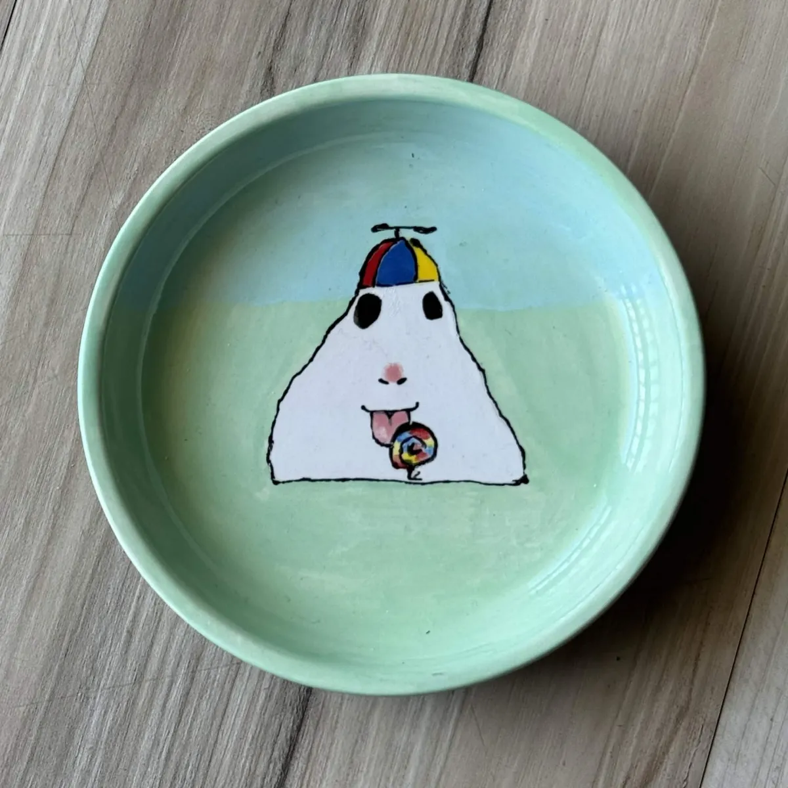
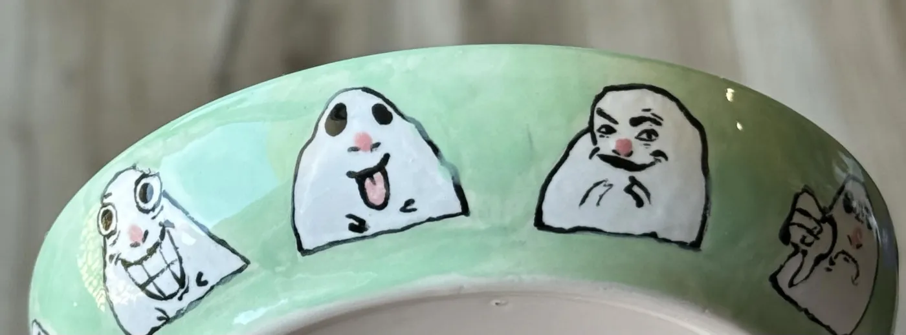
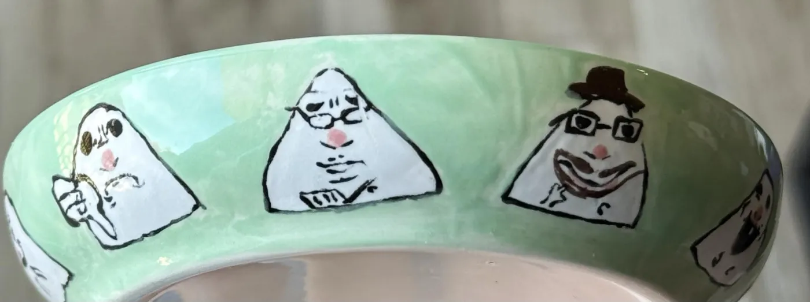
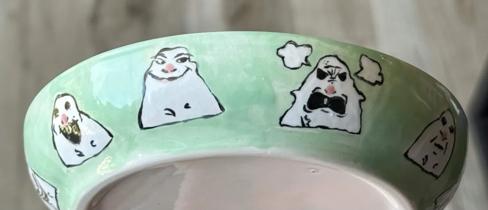

I adore a genre of poorly drawn but highly expressive hamsters. I brought them from my phone into reality by drawing eleven of them onto a shallow 5-inch diameter plate.

Right now, they watch over some extra keys for my apartment.

(I hope to replace these images with better ones later)