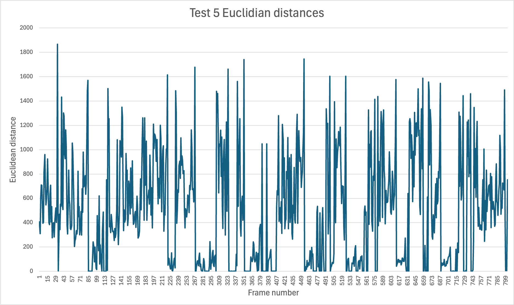

___
UIUC has great infrastructure to record engineering lectures. However, videos are not fully accessible to students with vision, hearing, or attention disabilities.  We aim to automatically produce video transcripts paired with key frames.  


**TL;DR**: Existing work to perform scene detection on lecture videos can be prone to mis-detections caused by content scrolling and handwritten annotations.  For scrolling, we use feature matching and drop a frame if its estimated translation is greater than 1 pixel.  For annotations, we perform a mask-like subtraction and drop a frame if its pixel change is less than 1%.  In the worst-performing video, precision rose from 25% to 80%.

Technically, I have a [first-author paper published in the ASEE IL/IN Regional Conference 2026](https://peer.asee.org/58101).
___

> **Scene detection**: the process of merging visually similar frames into a single video segment, and subsequent extraction of semantic features from the video segment (e.g., title, words, transcription segment and representative image)

My research concerns identifying segment boundaries and extracting key frames to improve scene detection.

## Part 1: how it works
We focus on filtering out false positives in the output of my professor's [existing scene detection research](https://peer.asee.org/41185) caused by content scrolling and handwritten annotations.

The problem has the following characteristics:
- The input has a low sampling rate of 0.5-2 fps
- Spatially and chromatically sparse frames, relative to images of people or landscapes
- Large and small motion in vertical and horizontal axes
- Handwritten annotations

We assume that the last frame of a segment is complete.  By extension, we keep the last frame of a video by default.

Working in reverse, we compare each frame to the most recently kept frame.  Let `candidate` and `reference` be two frames where `candidate` is chronologically earlier and `reference` is the most recently kept frame.  If scrolling is not detected between `candidate` and `reference`, we check for annotations.  If annotations are not detected, we keep `candidate`.  The set of kept frames is the filtered output.

### Scrolling
1. Crop the edges of `reference` to remove persistent UI elements like sidebars.
2. Extract features from each frame using Lowe's Scale-Invariant Feature Transform.
3. Match features between frames using the Fast Library for Approximate Nearest Neighbors.
4. Estimate a partial affine transformation between frames to estimate scaling and translation.
5. If the estimated translation is greater than 1 pixel, `candidate` is dropped.  Otherwise, `candidate` is kept.

This method works and handles large and small motion, even with the low sampling rate, while being robust to relatively sparse frames.

### Annotations
1. Set background pixels from both frames to black (0,0,0), producing `foreground_cand` and `foreground_ref`.
2. Perform a mask-like subtraction to calculate `difference`, the pixels unique to `candidate`, calculated with the following for all `x` and `y`
    ```
    difference += 1 if (foreground_ref[x][y] == (0, 0, 0) 
                        and foreground_ref[x][y] != foreground_cand[x][y])
                    else 0
    ```
3. If the fraction of different pixels relative to all pixels is greater than or equal to 1%, `candidate` is kept.  Otherwise, `candidate` is dropped.

This method works, handles the incremental changes found in annotations, and does not require parsing handwritten annotations into text.

## Part 2: why not use a model?
Model requirements:
- A vision model, to process images.
- A local open-source model to avoid sending student information to third parties.

### Question 1: given several frames from a video, could a local vision LLM choose key frames?

No. PaliGemma outright refused to describe or select an image.  LLaVA and Llama had poor descriptions and would not select an image.

However, this was tested in fall 2024, when relatively few models supported vision and open-source models were much weaker. Additionally, none of the models supported multiple image upload.  We tested by stitching two images together and asking the model to describe both images and select one.  With the rapid growth of local open-source models, I expect that model performance has drastically improved.

### Question 2: given the embeddings for each frame from a video, could we identify segment boundaries?

No. We used VGG-16 to convert video frames into vector embeddings and took the Euclidean distance between `candidate` and `reference` frames, as defined above.  However, distances were too noisy to determine segment boundaries.



(these spikes do not correspond with segment boundaries)